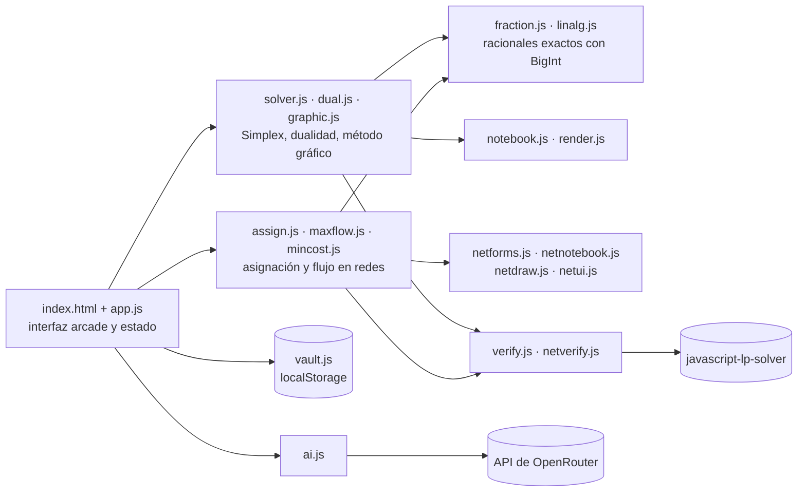

<p align="center"></p>

<p align="center"><a href="README.md">English</a> · <strong>Español</strong></p>

<p align="center">
  <b>Una calculadora de Investigación de Operaciones con alma de arcade retro.</b><br>
  Simplex Revisado, dualidad, asignación, flujo máximo y flujo a costo mínimo — resueltos con fracciones exactas y explicados paso a paso como en una hoja de cuaderno.
</p>

<p align="center">
  
  
  
  
  
  
  
</p>

<p align="center">
  
</p>

> Todo corre en el navegador: sin servidor, sin compilación y sin instalación.

## Características

- **Cinco modos de juego** — `1P` Simplex Revisado, `2P` Dualidad, `3P` Asignación, `4P` Flujo máximo y `5P` Costo mínimo, cada uno con su formulario y su pantalla de resultado.
- **Aritmética exacta** — todos los cálculos usan números racionales con `BigInt` (y valores simbólicos con Gran M): no hay errores de redondeo de punto flotante.
- **Cuaderno paso a paso** — cada solución se escribe como una hoja de cuaderno: B⁻¹, π = c_B·B⁻¹, costos reducidos, razón mínima y matrices eta; tablas húngaras con líneas y ceros encerrados; caminos de aumento dibujados sobre la red.
- **Simplex Revisado** — forma producto de la inversa, Gran M o Dos Fases para las variables artificiales, y variables ≥ 0, ≤ 0 o irrestrictas.
- **Dualidad** — construye el dual con las reglas de signos, lo resuelve y comprueba la dualidad fuerte, los precios sombra y la holgura complementaria.
- **Método gráfico** — despejes, esquinas de la región y gráfica en SVG, opcionales para modelos de dos variables.
- **Asignación (Kuhn-Munkres)** — método húngaro con casos particulares: problemas no balanceados (filas o columnas ficticias), maximización (pérdida de oportunidad), asignaciones prohibidas (costo M), agentes con varias tareas y aviso de óptimos múltiples.
- **Flujo en redes** — flujo máximo con Edmonds-Karp y corte mínimo, y rutas más baratas sucesivas (Bellman-Ford) para el flujo a costo mínimo, con nodos ficticios y redes no dirigidas.
- **Resultados comprobados** — cada respuesta se verifica de forma independiente con `javascript-lp-solver` 1.0.3; los problemas de redes también se resuelven como programación lineal y las asignaciones pequeñas por fuerza bruta. Solo aparece un aviso si algo no coincide.
- **Bóveda de ejercicios** — 15 ejercicios de libro precargados por tema, más tus propios ejercicios guardados en `localStorage` con exportación e importación en JSON. Enlaces como `index.html#m11&run` cargan y resuelven un ejercicio.
- **Sensación arcade** — fuentes Press Start 2P y VT323, líneas de monitor CRT y sonidos de 8 bits generados con la Web Audio API.
- **Explicaciones con IA (opcional)** — "Explicar a detalle" le pide a un modelo gratuito de OpenRouter que explique cada paso del cuaderno con lenguaje llano. La clave se queda en el `localStorage` de tu navegador.

## Capturas

<table>
  <tr>
    <td width="50%"><br><sub><b>1P · Simplex Revisado</b> — una iteración en el cuaderno</sub></td>
    <td width="50%"><br><sub><b>Método gráfico</b> — región factible y recorrido del Simplex</sub></td>
  </tr>
  <tr>
    <td width="50%"><br><sub><b>2P · Dualidad</b> — primal vs dual, Z* = W*</sub></td>
    <td width="50%"><br><sub><b>3P · Asignación</b> — líneas y asignación final</sub></td>
  </tr>
  <tr>
    <td width="50%"><br><sub><b>4P · Flujo máximo</b> — el corte mínimo iguala al flujo máximo</sub></td>
    <td width="50%"><br><sub><b>5P · Costo mínimo</b> — envíos y costo total</sub></td>
  </tr>
</table>

## Tecnologías

| Capa | Herramientas |
|---|---|
| Interfaz | HTML5, JavaScript puro (módulos IIFE sobre un espacio de nombres `SX`), Tailwind CSS por CDN y `arcade.css` propio |
| Motor matemático | Fracciones con `BigInt`, álgebra matricial, Simplex Revisado, método húngaro, Edmonds-Karp y rutas más baratas sucesivas |
| Gráficos | SVG en línea para gráficas y redes, Web Audio API para los sonidos |
| Verificación | `javascript-lp-solver` 1.0.3 (navegador y Node.js), permutaciones por fuerza bruta |
| Pruebas | Scripts de Node.js; prueba de interfaz opcional con Playwright + Firefox |
| Documentación | Libros en LaTeX y presentaciones Beamer, compilados con `pdflatex` |
| IA opcional | API de OpenRouter (modelos gratuitos) |

## Arquitectura



## Cómo empezar

**Solo ábrela.** Doble clic en `index.html`. Las fuentes, Tailwind y la librería de verificación se cargan desde un CDN; todos los cálculos corren en tu equipo.

O sírvela con cualquier servidor estático:

```bash
git clone https://github.com/waldooCreator/CLC.git
cd CLC
python3 -m http.server 5173
# abre http://localhost:5173
```

Ir directo a un ejercicio: `index.html#m11` carga el ejercicio 11 de la bóveda e `index.html#m11&run` además lo resuelve.

### Ejecutar las pruebas

```bash
cd tests
npm install
node run.mjs      # los 15 ejercicios: calculadora = libro = PDF = PL = librería
node bordes.mjs   # casos borde y explicación con IA simulada
node dump.mjs 11  # imprime el cuaderno de un ejercicio en texto
node ui.mjs       # opcional: clics reales en Firefox (requiere Playwright)
```

### Opcional: explicaciones con IA

1. Crea una cuenta en [openrouter.ai](https://openrouter.ai) y genera una API key.
2. Pulsa **OPENROUTER** en la app, pega la clave y elige un modelo gratuito.

La calculadora funciona por completo sin esto.

## Estructura del proyecto

```text
CLC/
├── index.html            # aplicación de una sola página
├── css/arcade.css        # estilos pixel/CRT
├── js/                   # motor matemático, cuaderno, interfaz, bóveda, cliente de IA
├── tests/                # scripts de prueba en Node.js (run, bordes, dump, ui)
└── documentacion/
    ├── 01-simplex-revisado/ … 05-flujo-costo-minimo/   # un PDF por tema
    └── otros/            # fuentes LaTeX, presentaciones Beamer, guía de la calculadora
```

## Documentación

`documentacion/` tiene un PDF por tema, cada uno con la explicación del método y tres ejercicios resueltos paso a paso — los mismos 15 ejercicios que vienen en la bóveda:

| Carpeta | Tema |
|---|---|
| `01-simplex-revisado` | Método Simplex Revisado |
| `02-asignacion-kuhn-munkres` | Problema de asignación y Kuhn-Munkres |
| `03-casos-particulares-asignacion` | Casos particulares de la asignación |
| `04-flujo-maximo` | Flujo máximo |
| `05-flujo-costo-minimo` | Flujo a costo mínimo |

Los ejercicios vienen de libros clásicos de Investigación de Operaciones (Hillier y Lieberman, Taha, Winston, Anderson-Sweeney-Williams). En `documentacion/otros/` están las fuentes LaTeX, las presentaciones Beamer y una guía en HTML que muestra cómo escribir cada ejercicio en la calculadora.

## Autor

**Walter Velasco** — [@waldooCreator](https://github.com/waldooCreator)
