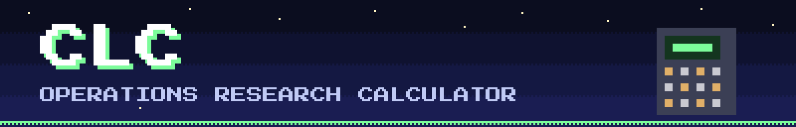
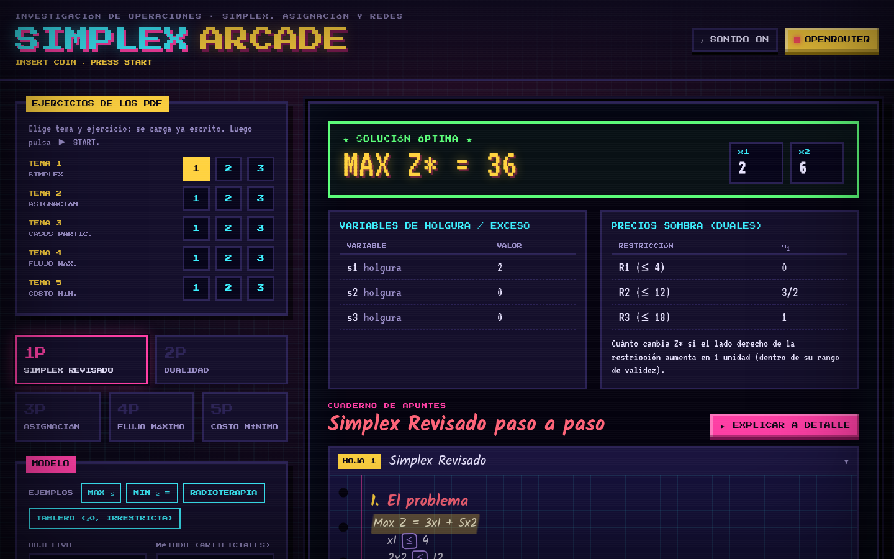
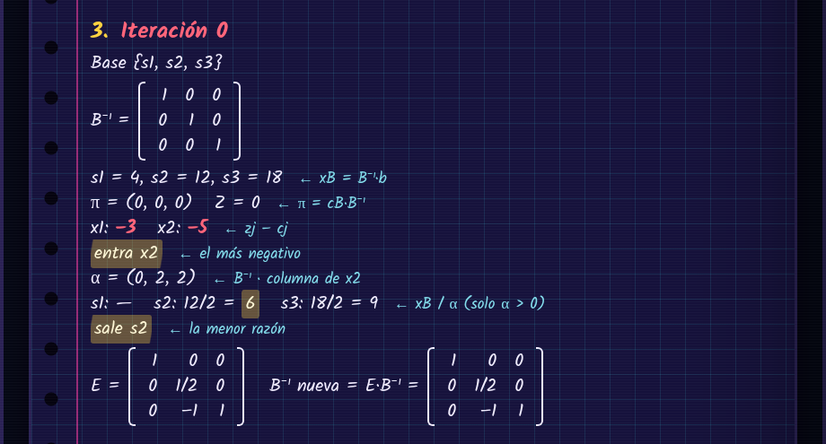
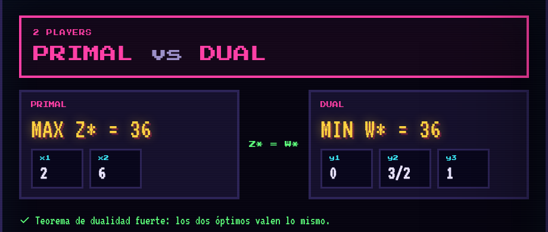
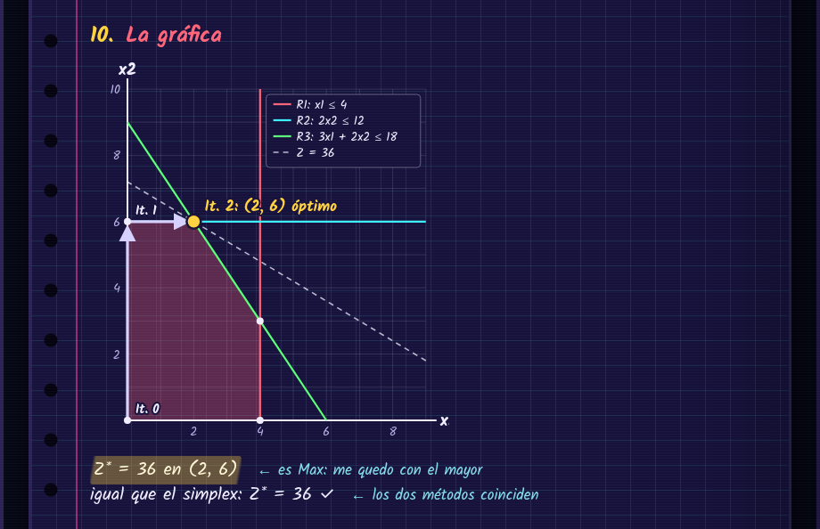
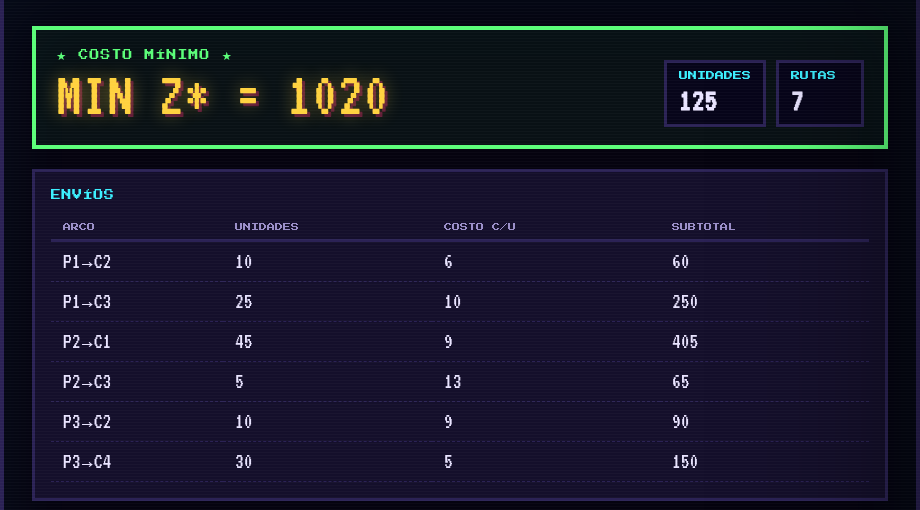
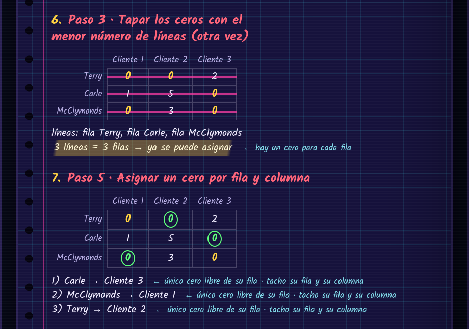
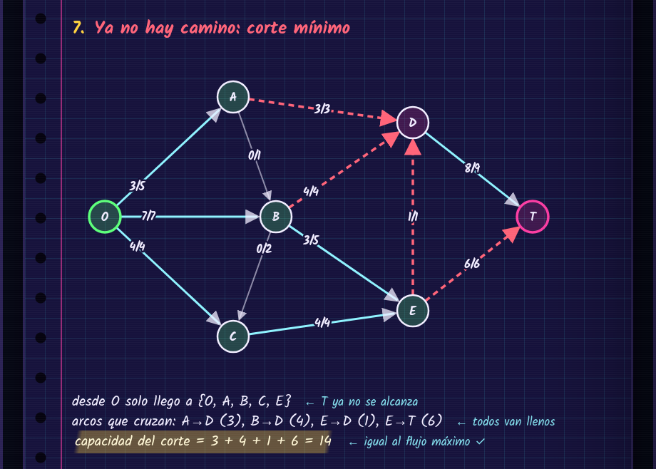
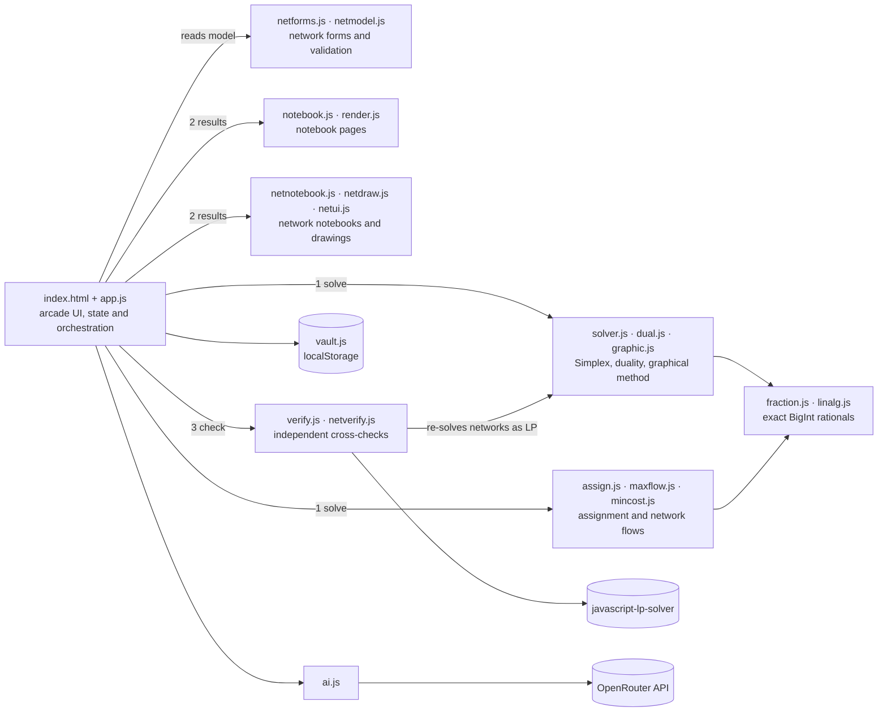

<p align="center"></p>

<p align="center"><strong>English</strong> · <a href="README.es.md">Español</a></p>

<p align="center">
  <b>CLC — Simplex Arcade: an Operations Research calculator with a retro arcade soul.</b><br>
  Revised Simplex, duality, assignment, maximum flow and minimum-cost flow — solved with exact fractions and explained step by step like a handwritten notebook.
</p>

<p align="center">
  
  
  
  
  
  
  
</p>

<p align="center">
  
</p>

> The interface is in Spanish (it was built for an Operations Research course). Everything runs in the browser: no server, no build step, no install.

## Features

- **Five game modes** — `1P` Revised Simplex, `2P` Duality, `3P` Assignment, `4P` Maximum flow and `5P` Minimum-cost flow, each with its own form and result screen.
- **Exact arithmetic** — every computation uses rational numbers backed by `BigInt` (plus symbolic Big M values), so there are no floating-point rounding errors.
- **Step-by-step notebook** — each solution is written out as a lined notebook page: B⁻¹, π = c_B·B⁻¹, reduced costs, ratio test and eta matrices; Hungarian tables with covering lines and circled zeros; augmenting paths drawn on the network.
- **Revised Simplex** — product form of the inverse, Big M or Two-Phase for artificial variables, and variables that are ≥ 0, ≤ 0 or free.
- **Duality** — builds the dual with the sign rules, solves it, and checks strong duality, shadow prices and complementary slackness.
- **Graphical method** — optional intercepts, corner points and an SVG plot for two-variable models.
- **Assignment (Kuhn–Munkres)** — Hungarian method with special cases: unbalanced problems (dummy rows/columns), maximization (opportunity loss), forbidden assignments (cost M), agents with several tasks, and a multiple-optima warning.
- **Network flows** — Edmonds–Karp maximum flow with minimum cut, and successive shortest paths (Bellman–Ford) for minimum-cost flow, including dummy nodes and undirected networks.
- **Cross-checked results** — every answer is verified independently against `javascript-lp-solver` 1.0.3; network problems are also re-solved as linear programs, and small assignments by brute force. A warning appears only if something disagrees.
- **One-click textbook exercises** — the *Ejercicios de los PDF* panel loads any of the 15 exercises solved in the PDFs (topic 1–5 × exercise 1–3) straight into the form, ready to compare with its report.
- **Exercise vault** — 15 textbook exercises preloaded by topic, plus your own saved exercises in `localStorage` with JSON export/import. Deep links like `index.html#m11&run` load and solve an exercise.
- **Arcade feel** — Press Start 2P and VT323 fonts, CRT scanlines and 8-bit sounds generated with the Web Audio API.
- **Optional AI explanations** — "Explicar a detalle" asks a free model on OpenRouter to explain each notebook step in plain language. The API key stays in your browser's `localStorage`.

## Screenshots

<table>
  <tr>
    <td width="50%" valign="top"><br><sub><b>1P · Revised Simplex</b> — one iteration in the notebook</sub></td>
    <td width="50%" valign="top"><br><sub><b>2P · Duality</b> — primal vs dual, Z* = W*</sub></td>
  </tr>
  <tr>
    <td width="50%" valign="top"><br><sub><b>Graphical method</b> — feasible region and Simplex path</sub></td>
    <td width="50%" valign="top"><br><sub><b>5P · Minimum-cost flow</b> — shipments and total cost</sub></td>
  </tr>
  <tr>
    <td width="50%" valign="top"><br><sub><b>3P · Assignment</b> — covering lines and final assignment</sub></td>
    <td width="50%" valign="top"><br><sub><b>4P · Maximum flow</b> — minimum cut equals max flow</sub></td>
  </tr>
</table>

## Tech stack

| Layer | Tools |
|---|---|
| Interface | HTML5, vanilla JavaScript (IIFE modules on a shared `SX` namespace), Tailwind CSS via CDN, hand-written `arcade.css` |
| Math engine | Custom `BigInt` fractions, matrix algebra, Revised Simplex, Hungarian method, Edmonds–Karp, successive shortest paths |
| Graphics | Inline SVG for plots and network drawings, Web Audio API for sounds |
| Verification | `javascript-lp-solver` 1.0.3 (browser and Node.js), brute-force permutations |
| Tests | Node.js scripts; optional UI test with Playwright + Firefox |
| Documentation | LaTeX books and Beamer slide decks, compiled with `pdflatex` |
| Optional AI | OpenRouter API (free models) |

## Architecture



## Getting started

**Just open it.** Double-click `index.html`. Fonts, Tailwind and the verification library load from a CDN; all calculations run locally.

Or serve it with any static server:

```bash
git clone https://github.com/waldooCreator/CLC.git
cd CLC
python3 -m http.server 5173
# open http://localhost:5173
```

Jump straight to an exercise: `index.html#m11` loads vault exercise 11, and `index.html#m11&run` also solves it.

### Run the tests

```bash
cd tests
npm install
node run.mjs      # the 15 exercises: calculator = textbook = PDF = LP = library
node bordes.mjs   # edge cases and a mocked AI explanation
node dump.mjs 11  # print the notebook of one exercise as text

# optional: real clicks in Firefox (Playwright is not a dependency, install it first)
npm i --no-save playwright@1.48.2 && npx playwright install firefox
node ui.mjs
```

`npm test` is a shortcut for `node run.mjs`.

### Optional: AI explanations

1. Create an account at [openrouter.ai](https://openrouter.ai) and generate an API key.
2. Press **OPENROUTER** in the app, paste the key and pick a free model.

The calculator works fully without it.

## Project structure

```text
CLC/
├── index.html            # single-page app
├── css/arcade.css        # pixel/CRT styles
├── js/                   # math engine, notebook rendering, UI, vault, AI client
├── tests/                # Node.js test scripts (run, bordes, dump, ui)
└── documentacion/
    ├── 01-simplex-revisado/ … 05-flujo-costo-minimo/   # one PDF per topic
    └── otros/            # LaTeX sources, Beamer decks, calculator guide
```

## Documentation

`documentacion/` holds one PDF per topic, each explaining the method and solving three exercises step by step — the same 15 exercises preloaded in the vault:

| Folder | Topic |
|---|---|
| `01-simplex-revisado` | Revised Simplex method |
| `02-asignacion-kuhn-munkres` | Assignment problem and Kuhn–Munkres |
| `03-casos-particulares-asignacion` | Special cases of assignment |
| `04-flujo-maximo` | Maximum flow |
| `05-flujo-costo-minimo` | Minimum-cost flow |

Exercises are adapted from classic Operations Research textbooks (Hillier & Lieberman, Taha, Winston, Anderson–Sweeney–Williams). `documentacion/otros/` contains the LaTeX sources, the Beamer presentations and an HTML guide showing how to enter each exercise into the calculator.

## Author

**Walter Velasco** — [@waldooCreator](https://github.com/waldooCreator)
